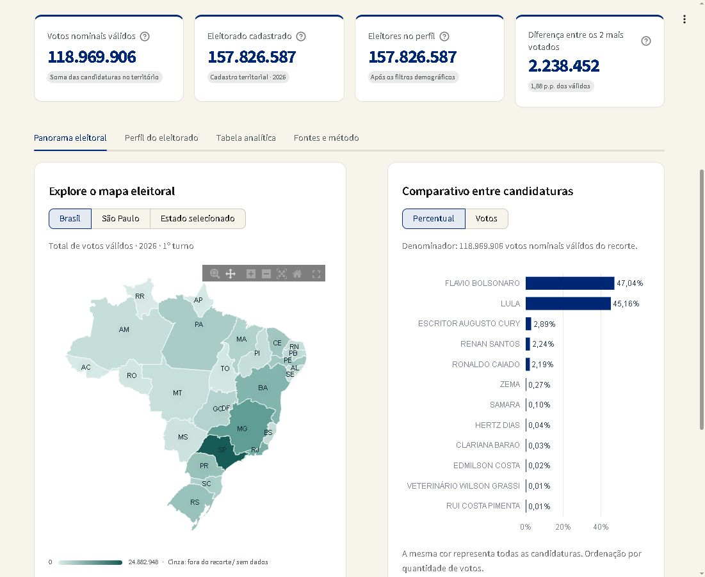
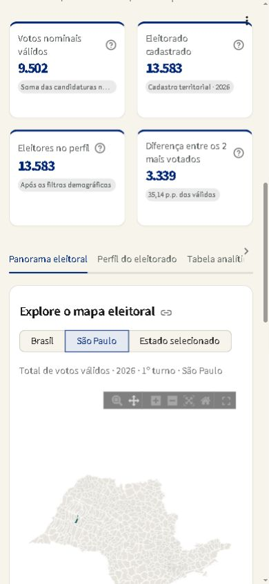

# Validação local do Lampiadim — 26/10/2026

## Executado

- Preparação dos arquivos reais do projeto: 118.969.906 votos nominais válidos,
  157.826.587 eleitores cadastrados, 5.571 municípios, 12 candidaturas.
- Reconciliação integral da votação municipal/candidatura e de todos os grupos
  município/sexo/identidade do perfil contra os CSVs anteriores. As novas
  dimensões de idade/escolaridade não alteraram esses totais.
- 36 testes automatizados aprovados: cálculos, interseções, DDD, CSV reaberto,
  ausência de dados, homônimos, conversa com contexto, contrato do provedor e
  navegação real no runtime de testes do Streamlit. Relatório JUnit:
  `testes-lampiadim.xml`.
- Browser local: carregamento dos gráficos, filtros de estado e município,
  perfil por sexo/idade/escolaridade/identidade, tabela com busca, fontes e chat.
- Seleção no mapa Brasil → SP: 24.882.948 votos e 34.104.226 cadastrados.
- Seleção de ponto municipal no mapa SP → Lucélia: 9.502 votos, 13.583 cadastrados.
- Após a seleção municipal, limpar filtros restaurou Brasil, todos os municípios
  e 118.969.906 votos. Foi corrigida a reutilização de uma seleção Plotly antiga.
- Americana/SP: 136.589 votos, 180.962 cadastrados. Perfil feminino: 95.958.
  Selecionar candidatura ou perfil não altera o denominador eleitoral territorial.
- CSV baixado pelo **navegador**, buscando LULA em Americana, foi reaberto com
  Pandas: uma linha, 37.768 votos e 27,65083571883534% dos válidos municipais.
- Chat no navegador: resposta sobre Americana com fonte/denominadores e tabela;
  mensagens do usuário à direita, assistente à esquerda, avatar e campo de entrada.
  Histórico/nova conversa/retorno aos filtros também exercitados em AppTest.
- Renderização em computador, tablet 768×1024 e celular 390×844; largura do
  documento igual à viewport nas verificações estreitas, sem scroll horizontal
  da página. Tabelas e abas têm rolagem própria quando necessário.
- Console do navegador: nenhum erro capturado na inspeção realizada.
- `compileall` e `git diff --check` executados. Notebook e CSVs de origem não
  foram modificados.

## Cobertura territorial

Tabela de DDD obtida da Anatel e conferida por código IBGE. 5.561 municípios
validados, sem duplicação de quantidades na junção. Dez pendências explícitas:
Dona Eusébia/MG, Figueirão/MS, Boa Esperança do Norte/MT, Ipiranga do Norte/MT,
Itanhangá/MT, Nazária/PI, Aroeiras do Itaim/PI, Munhoz de Mello/PR,
Espigão do Oeste/RO e Alvorada do Oeste/RO.

Todos os 645 municípios paulistas têm DDD validado e vínculo com as malhas.
Cinco municípios do conjunto nacional não têm geometria vinculada; seus dados
permanecem nas tabelas e totais. A interface informa a lacuna no recorte afetado.
As exceções e as nove correspondências resolvidas pela Anatel estão registradas
no manifesto, com hashes e fontes.

## Limites da verificação

- IA generativa: integração implementada e contrato/fallback testados com
  transporte controlado. Não houve chamada real: faltam `OPENAI_API_KEY` e
  `OPENAI_MODEL` no ambiente do servidor. O modo local está funcional.
- Não houve deploy remoto nem build Docker. Os arquivos para execução/container
  e as instruções estão incluídos; isso não é comprovação de produção.
- Não foi executada auditoria manual com leitor de tela, nem homologação em
  aparelhos físicos, Safari ou Firefox. A verificação responsiva usa viewport
  de navegador; não simula todas as características dos dispositivos.
- Comparecimento/abstenção/aptos da totalização e série histórica seguem
  indisponíveis por ausência das respectivas bases. Somente 2026/1º turno foi
  encontrado no arquivo de votação utilizado.
- A reconciliação é contra os dados TSE fornecidos no projeto, não uma afirmação
  de atualização contínua ou de igualdade ao arquivo publicado hoje pelo TSE.

## Evidência visual

## Ambiente testado

Python 3.13.14; Streamlit 1.66.1; Pandas 3.1.0; Plotly 6.9.0; PyArrow 26.0.0;
HTTPX 0.28.1; Requests 2.34.2; OpenPyXL 3.1.5; Pytest 9.1.1.
